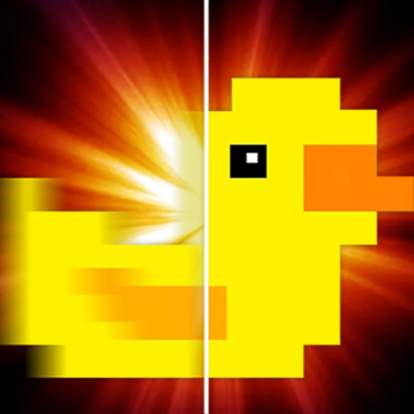

# Decky LSFG-VK

> This is an **unofficial community plugin**. It is independently developed and **not officially supported** by the creators of Lossless Scaling or lsfg-vk. For support, please use the [decky-lsfg-vk Discord Channel](https://discord.gg/TwvHdVucC3).

   

   

Decky LSFG-VK is a Decky plugin that streamlines the installation of **lsfg-vk** ([Lossless Scaling Frame Generation Vulkan layer](https://lsfg-vk.dev/)) on Steam Deck, allowing you to use the Lossless Scaling frame generation features on Linux with a controller friendly UI in SteamOS, Bazzite, or any other Linux platform compatible with Decky Loader.

## Installation

1. **Download the plugin** from the [releases tab](https://github.com/xXJSONDeruloXx/decky-lsfg-vk/releases)
   - Download the "Decky LSFG-VK.zip" file to your Steam Deck
2. **Install manually through Decky**:
   - In Game Mode, go to the settings cog in the top right of the Decky Loader tab
   - Enable "Developer Mode"
   - Go to "Developer" tab and select "Install Plugin from Zip"
   - Select the downloaded "Decky LSFG-VK.zip" file

## How to Use

1. **Purchase and install** [Lossless Scaling](https://store.steampowered.com/app/993090/Lossless_Scaling/) from Steam
2. **Switch Branch** In the Lossless Scaling Steam app, go to Properties > Game Versions & Betas > select "lsfg-vk" branch, and let Steam download the new version
2. **Open the plugin** from the Decky menu
3. **Click "Install lsfg-vk"** to automatically set up the lsfg-vk vulkan layer
4. **Configure settings** using the plugin's UI - select Default or a running/configured game and adjust the upstream lsfg-vk settings
5. **Configure Flatpak apps** in the Flatpak tab individually or with **Enable all** and **Remove all profiles**
6. **Launch your game** - frame generation activates when the game's Steam AppID matches an assigned upstream profile

### Core Settings

- **Quality preset**: One-tap Quality, Balanced or Low latency profiles that set Flow Scale and Performance Mode together. Shows "Custom" once you adjust either by hand
- **FPS Multiplier**: Choose how many frames are shown per game frame (2x, 3x, 4x and up)
- **Flow Scale**: Resolution used to track motion between frames. Lower is faster and lighter, higher gives cleaner generated frames
- **Performance Mode**: Uses a much lighter frame generation model with a small quality cost (recommended on handhelds)
- **Present Mode Override**: Forces Vsync, which frame pacing needs. Leave on unless a game misbehaves
- **Preserve Swapchain Image Count**: Only for Vulkan games that crash on launch; can make pacing less smooth
- **FP16 Acceleration**: Use half-precision acceleration when supported

### Smoothness and latency

lsfg-vk currently offers a single pacing mode (Vsync), so smoothness comes from feeding it a steady frame rate:

- **Smooth pacing target**: In a game's Workarounds section, pick 30 → 60 (60 Hz), 45 → 90 or 30 → 90 (90 Hz OLED). It caps the game and sets the multiplier so output matches your screen. Best fix for uneven motion; a steady, lighter load also cuts input lag
- **Fewer artifacts**: For warping, bubbling or blur, use the Quality preset and keep the base FPS at 40+ where you can. Keep Present Mode Override on to avoid tearing
- **Base FPS Cap**: Shows the resulting output (cap x multiplier) so you can match your display's refresh rate, for example 30 x 3 on a 90 Hz screen
- **Low latency preset**: Faster generation shortens the delay frame generation adds. It does not remove Vsync latency

### Quality of life

- **Apply these settings to all games**: tune one game, then copy its settings to every other game profile in one tap
- **Game list summaries**: enabled games show their setup (for example "3x · Balanced") at a glance
- **Use these settings for new games**: set your preferred starting point once; every game you enable afterwards uses it (Settings > Advanced > Reset new-game defaults clears it)
- **Reset settings to defaults**: put one game back to the defaults without removing its profile
- **Export / import profiles**: Settings > Advanced saves all your game profiles to `~/lsfg-vk-profiles.json` and loads them back (with an automatic backup first), for moving to another Deck or sharing a setup
- **Check for lsfg-vk updates**: one button in Settings tells you whether upstream has released a newer lsfg-vk than the one bundled in the plugin
- **Restore previous config**: the last few versions of your config are kept automatically; Settings > Advanced > Restore previous config undoes recent changes (and can be undone itself)

## Feedback and Support

For per-game feedback and community support, please join the [decky-lsfg-vk Discord Channel](https://discord.gg/TwvHdVucC3)

## Credits

- **[PancakeTAS](https://lsfg-vk.dev/)** for creating the lsfg-vk Vulkan compatibility layer
- **[Lossless Scaling](https://store.steampowered.com/app/993090/Lossless_Scaling/)** developers for the original frame generation technology
- **[Deck Wizard](https://www.youtube.com/@DeckWizard)**  - Extensive community support including comprehensive guides, promotional content, thorough testing and feedback, custom artworks, and tutorial videos. His passionate advocacy and continuous support have been instrumental in this plugin's success.
- The **Decky Loader** team for the plugin framework
- Community contributors and testers for feedback and bug reports
